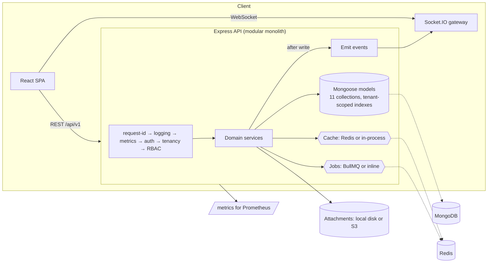

# FlowForge

**A scalable, real-time project management SaaS** — multi-tenant workspaces, role-based access control,
versioned Kanban boards with live collaboration, analytics, and an evidence-backed performance story.

Built as a production-shaped MERN/TypeScript monorepo: Express + MongoDB + Socket.IO + Redis on the
backend, React + Vite + TanStack Query on the frontend, Docker + GitHub Actions around all of it.

> New here? **[HOW_TO_RUN.md](./HOW_TO_RUN.md)** walks through setup and every feature, click by click.

---

## Why this is more than a CRUD app

Every claim below is enforced by code and checked by tests — not just described in a README.

| Claim | How it is enforced | Evidence |
| --- | --- | --- |
| Tenant isolation | Every workspace-owned query is scoped through a request context loader; non-members get `404`, never `403` | `apps/api/src/tests/tenancy.test.ts` (11 cross-tenant attack cases) |
| Concurrency safety | Tasks carry a `version`; writes are compare-and-set, conflicts return `409` with the latest payload | OCC race test: two same-version writes → exactly one winner |
| Secure sessions | Refresh tokens are opaque, stored only as SHA-256 hashes, rotated on use, with family reuse detection | `auth.test.ts`: replay after rotation revokes the family |
| Server-side RBAC | Role hierarchy (`owner > admin > member > viewer`) enforced in middleware and services | `rbac.test.ts` — viewers/ members/ admins each constrained |
| Measurable DB work | Compound indexes sized to the board query, verified with `explain` | p95 **17.6 ms → 1.8 ms**, docs examined **20,000 → 40** (`docs/BENCHMARKS.md`); at 400k documents, 88–229× p95 across the app's query shapes (`docs/SCALABILITY_EXPERIMENTS.md`) |
| Scale-out without losing correctness | Two API instances behind a load balancer with a shared Redis rate-limit store and a Socket.IO Redis adapter | 1.46–1.59× throughput, 0 errors, 30/60 logins under one shared budget, cross-instance event in 97 ms (Experiment 4) |
| Real-time correctness | Socket.IO rooms are joined only after a membership check; events fire only after successful writes | `realtime.test.ts` incl. foreign-room rejection |
| Reconnect sync | Clients refetch everything on socket reconnect and patch caches from events otherwise | `apps/web/src/hooks/useRealtime.ts` |

## Feature tour

**Six primary interfaces** (see HOW_TO_RUN for screenshots-by-description walkthroughs):

1. **Dashboard** — personal workload, deadlines, recent activity, team capacity.
2. **Project board** — Kanban columns with drag & drop, filters, live presence of who is viewing.
3. **Task detail** — comments, subtasks, file attachments, activity history, inline field editing.
4. **Team** — invitations with hashed single-use tokens, role management, pending-invite control.
5. **Analytics** — completion trend, workload distribution, status mix, cycle time, per-project progress.
6. **Settings** — workspace config, profile/preferences, active-session management, danger zone.

**Under the hood** — JWT access tokens + rotating refresh cookies, invitation emails through a queue,
attachments on a pluggable storage driver (local disk or any S3-compatible service), Prometheus metrics,
structured logs with redaction, rate limiting, and graceful degradation when Redis is absent.

## Repository layout

```
flowforge/
├── apps/
│   ├── api/                  # Express + Mongoose + Socket.IO (modular monolith)
│   │   ├── src/config/       # env validation, db, redis, logging, storage driver
│   │   ├── src/middleware/   # auth, tenancy loaders, RBAC, validation, errors, limits
│   │   ├── src/modules/      # auth, workspaces, projects, tasks, comments, attachments,
│   │   │                     # activity, notifications, analytics, users
│   │   ├── src/realtime/     # Socket.IO gateway (rooms, presence)
│   │   ├── src/jobs/         # BullMQ queues with an inline fallback
│   │   ├── src/tests/        # 66 integration tests against a real MongoDB
│   │   └── scripts/          # seed, benchmark, load smoke, e2e bootstrap
│   └── web/                  # React 19 + Vite + Tailwind v4 + TanStack Query + Zustand
│       ├── src/features/     # auth, dashboard, projects, board, task, team, analytics, settings
│       ├── src/components/   # design system (Radix-based) + layout shell
│       └── e2e/              # Playwright journeys
├── packages/
│   ├── shared/               # zod schemas, constants, DTO contracts (API ⇄ web)
│   └── config/               # shared TypeScript base config
├── infra/                    # docker (nginx), monitoring (Prometheus/Grafana)
├── load/k6/                  # k6 scenario with p95 thresholds
├── docs/                     # ARCHITECTURE, API, BENCHMARKS, DEMO + measured JSON artifacts
├── docker-compose.yml        # mongo + redis + api + web
└── .github/workflows/        # CI (verify + e2e + images) and CD (GHCR + SSH)
```

## Architecture in one picture



Details, schema and data flows: [docs/ARCHITECTURE.md](./docs/ARCHITECTURE.md).

## Quick start

```bash
git clone <your-fork> flowforge && cd flowforge
npm install --include=dev          # see Troubleshooting if NODE_ENV=production is set
cp .env.example .env               # dev defaults work as-is
npm run seed                       # demo workspace, users, tasks (password: Password123!)
npm run dev                        # API on :4000, web on :5173
```

Open http://localhost:5173 and sign in as `aarav.mehta@flowforge.dev` / `Password123!`.

**Prefer containers?** `docker compose up --build` → http://localhost:8080 (MongoDB + Redis included).

## Verification status

Run everything locally with `npm run typecheck && npm test && npm run build`.

| Check | Status | Detail |
| --- | --- | --- |
| API typecheck / build | ✅ passing | `tsc --noEmit`, `tsup` bundle |
| API integration tests | ✅ 66 passing | real MongoDB; tenancy, RBAC, OCC, pagination, invitations, sockets |
| Web typecheck / build | ✅ passing | route-level code splitting (initial JS 195 kB gzip) |
| Web unit tests | ✅ 16 passing | API client refresh single-flight, drag-drop math, task card |
| Query benchmark | ✅ measured | `docs/benchmark-results.json` (10× p95; 20,000 → 40 docs examined with the compound index) |
| HTTP load smoke | ✅ measured | `docs/load-smoke-results.json` — see honest interpretation below |
| Scalability experiments (6) | ✅ all measured | **`docs/SCALABILITY_EXPERIMENTS.md`** — load at 10/50/100 conns, 400k-document DB scaling, caching (100 % hit ratio, single-flight), horizontal scaling (1.46–1.59×), concurrent writes (0 lost updates, 0 duplicate events), failure drills (0 failed requests, 0 jobs lost) |
| E2E (Playwright) | ✅ 6 passing | `npm run e2e` walks register → workspace → board → task → comment, plus filters |

**Honest performance note.** On one instance, dashboard and project reads hold p97.5 ≈ 190–245 ms at 50
concurrent connections and the analytics read reaches 413 rps with a warm cache; the board read now
returns *every* task of a project (48 in the test dataset) and serves 190 rps at 100 connections, down
from 139 rps when it was silently truncating to 25 tasks. At 100 connections a single process on this
machine saturates (~200 rps) and latency queues — that is a property of the topology (load generator,
API and MongoDB sharing one CPU), not a capacity claim. Two instances behind a load balancer lift
throughput 1.46–1.59× at equal or better tail latency, and the failure drills show zero failed
requests through a rolling restart. Methodology, raw artifacts and per-scenario tables:
[`docs/SCALABILITY_EXPERIMENTS.md`](./docs/SCALABILITY_EXPERIMENTS.md).

## Known limitations

- Access tokens remain valid for up to 15 minutes after a session is revoked (short-TTL trade-off; revocation is immediate for refresh).
- Without Redis the cache and job queue are in-process — correct for a single instance, not shared across replicas.
- The S3 storage driver is implemented and type-checked but has not been exercised against a live bucket in this environment.
- Email delivery logs to the console unless `SMTP_URL` is configured; invitation links are also returned to admins so the flow works offline.
- Presence (who is viewing a board / "N people online") is counted with `fetchSockets()`, so it is
  correct across replicas when the Socket.IO Redis adapter is active; without Redis it is per-instance.
- Access caches (workspace document 30 s, membership 15 s, user existence 30 s) bound how quickly a
  direct database change propagates: a role change applies within 15 s worst case (immediately via
  invalidation, globally when Redis is shared) and a user row deleted outside the API keeps working
  for up to 30 s — the same bounded-staleness class as the 15-minute access-token window.
- Password reset / email verification are not implemented.

## Documentation map

- **[docs/PROJECT_GUIDE.md](./docs/PROJECT_GUIDE.md)** — the complete guide: every feature with screenshots, the design system, architecture, verification and limitations.
- **[HOW_TO_RUN.md](./HOW_TO_RUN.md)** — setup, demo accounts, and how to exercise every feature.
- **[DECISIONS.md](./DECISIONS.md)** — environment facts, conventions, and the decisions behind the code.
- **[docs/ARCHITECTURE.md](./docs/ARCHITECTURE.md)** — modules, data model, request lifecycle, realtime design, security model.
- **[docs/API.md](./docs/API.md)** — endpoint reference with permissions and error codes.
- **[docs/BENCHMARKS.md](./docs/BENCHMARKS.md)** — methodology and measured results.
- **[docs/SCALABILITY_EXPERIMENTS.md](./docs/SCALABILITY_EXPERIMENTS.md)** — the six scalability experiments with raw numbers, artifacts and reproduction commands.
- **[docs/DEMO.md](./docs/DEMO.md)** — the 7-scenario demo script.

## License

MIT — build on it freely.
