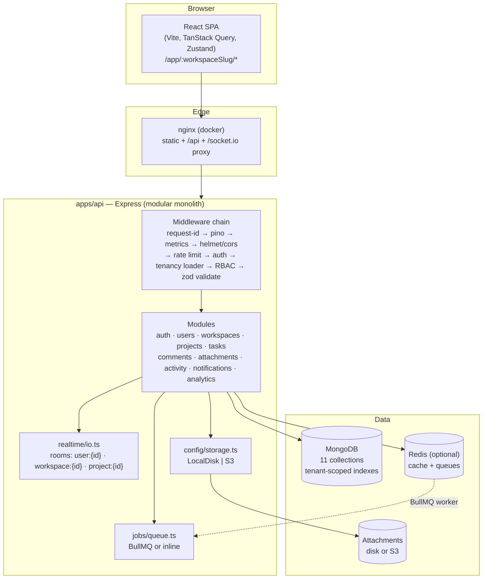
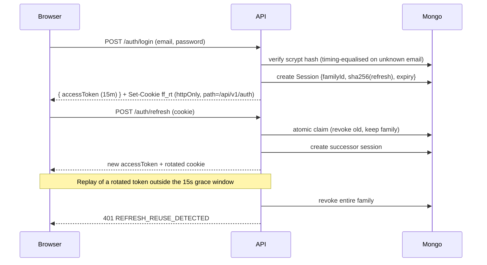

# FlowForge Architecture

## 1. System overview



The API is a **modular monolith**: one deployable, but each domain lives in its own module with a
route file (HTTP concerns), a service file (business rules) and shared models. This keeps boundaries
honest while avoiding distributed-system overhead before it is earned.

## 2. Request lifecycle

Every `/api/v1` request flows through the same chain:

1. **`requestIdMiddleware`** — attaches/propagates `x-request-id`.
2. **`pino-http`** — structured log line per request (secrets redacted).
3. **`metricsMiddleware`** — Prometheus histogram/counter with the matched route label.
4. **`helmet`, `cors`, `compression`, `express.json` (1 MB), `cookie-parser`**.
5. **Rate limiters** — global 600/min, auth 30/15 min, uploads 60/min (skipped in tests).
6. **`requireAuth`** — verifies the JWT access token, loads the user id.
7. **Tenancy loader** — `requireWorkspace | requireProject | requireTask | requireComment` resolves the
   resource, loads the caller's **membership**, and 404s when the caller is not a member.
8. **`requireRole(min)`** — server-side RBAC gate.
9. **`validate({ body, query, params })`** — zod parsing with defaults; handlers trust the result.
10. **Handler → service** — all queries filtered by `ctx.workspace._id`; writes record activity.
11. **Error middleware** — maps `AppError`, zod, mongoose and multer errors to
    `{ error: { code, message, details?, requestId } }`.

## 3. Data model (11 collections)

```mermaid
erDiagram
  USER ||--o{ MEMBERSHIP : has
  WORKSPACE ||--o{ MEMBERSHIP : has
  WORKSPACE ||--o{ INVITATION : issues
  WORKSPACE ||--o{ PROJECT : contains
  PROJECT ||--o{ TASK : contains
  TASK ||--o{ TASK : "parentTaskId (1 level)"
  TASK ||--o{ COMMENT : has
  TASK ||--o{ ATTACHMENT : has
  WORKSPACE ||--o{ ACTIVITYLOG : records
  USER ||--o{ NOTIFICATION : receives
  USER ||--o{ SESSION : opens

  USER { string name email passwordHash preferences }
  WORKSPACE { string name slug ownerId settings }
  MEMBERSHIP { ObjectId workspaceId ObjectId userId enum role }
  INVITATION { string email enum role string tokenHash date expiresAt }
  PROJECT { string name key description status int taskSeq }
  TASK { string key title status priority assigneeIds labels dueDate position version completedAt }
  COMMENT { ObjectId taskId ObjectId authorId content editedAt }
  ATTACHMENT { ObjectId taskId string storageKey filename mimeType size }
  ACTIVITYLOG { string action entityType entityId metadata }
  NOTIFICATION { enum type title body link readAt }
  SESSION { string familyId refreshTokenHash expiresAt revokedAt replacedBy }
```

Notable constraints and indexes (see `apps/api/src/models/`):

| Index | Purpose |
| --- | --- |
| `membership { workspaceId, userId } unique` | one membership per user per workspace |
| `workspace.slug unique`, `project { workspaceId, key } unique` | readable, tenant-scoped identifiers |
| `task { workspaceId, projectId, status, position }` | board reads (measured 16.9× p95 win) |
| `task { workspaceId, assigneeIds, status, dueDate }` | "my tasks", workload, overdue |
| `task { workspaceId, parentTaskId }`, `{ workspaceId, createdAt, _id }`, text `{title, description}` | subtasks, cursor feeds, search |
| `activity { workspaceId, createdAt, _id }`, `{ workspaceId, taskId, createdAt }` | feeds |
| `invitation.expiresAt` TTL, `session.expiresAt` TTL | automatic cleanup |
| `session.refreshTokenHash unique`, `invitation.tokenHash unique` | hashed secrets only |

## 4. Authentication and session design



- Access tokens are stateless JWTs (`sub`, `sid`) — no DB hit per request.
- Refresh tokens never touch the database in plaintext.
- The web client performs **single-flight refresh**: concurrent 401s share one refresh call, which is
  what makes the grace window sufficient (see `apps/web/src/lib/api.ts`).

## 5. Realtime design

- Socket.IO authenticates with the access token during the handshake.
- `workspace:join` and `project:join` re-verify membership server-side; foreign rooms get
  `{ ok: false }` and never receive events.
- Rooms: `user:{id}` (notifications), `workspace:{id}` (task/comment/activity/member events),
  `project:{id}` (presence).
- **Events are emitted after the database write** — clients cannot observe unsaved state.
- Clients patch caches in place for `task:updated` (no refetch flicker) and invalidate for structural
  changes (`task:created`, `task:deleted`, comments, attachments).
- On reconnect the client re-joins rooms and invalidates all queries — the guaranteed resync path.
- Presence is tracked per instance (in-memory) and broadcast as viewer/id sets.

## 6. Attachments pipeline

```
upload → multer memory (10 MB, MIME allow-list) → StorageDriver.put(key) →
Attachment document → activity + socket event
download → auth → load attachment → membership check on its workspace → stream (Content-Disposition) →
409/404 for non-members (never a redirect to a public URL)
```

`LocalDiskDriver` (default) mirrors the interface of `S3Driver`, so switching `STORAGE_DRIVER=s3`
requires only credentials/endpoint configuration.

## 7. Caching, jobs and observability

| Concern | With Redis | Without Redis |
| --- | --- | --- |
| Analytics/dashboard snapshots | Redis keys with TTL, prefix-busted on writes | in-process Map with TTL (same semantics) |
| Workspace member "minis" | 30 s TTL, busted on membership writes | same |
| Email + notification delivery | BullMQ queue with retries/exponential backoff | inline `await` with identical outcomes |
| Rate limiting | in-memory (documented) | in-memory |
| Health/metrics | `/api/v1/health` reports `cache` and `queues` backend; `/metrics` exposes Prometheus data (request histograms, counters, websocket gauge, process metrics) |

## 8. Security model (summary)

- Passwords: scrypt (N=16384, r=8, p=1), never returned by the API.
- Sessions: hashed refresh tokens, rotation, reuse detection, revocable per session.
- Authorization: every workspace-owned resource is reached through a tenancy loader; role checks are
  server-side, the UI merely mirrors them.
- Input validation: zod at the boundary, MIME allow-list for uploads, filename sanitisation,
  `Content-Disposition` + `nosniff` on downloads.
- Query safety: Mongoose casts/escapes values; regex escapes used where patterns are built.
- Secrets: env-driven; `.env` gitignored; logs redact auth headers, cookies and token fields; the
  documented production posture requires TLS with `COOKIE_SECURE=true` and a rotated JWT secret.
